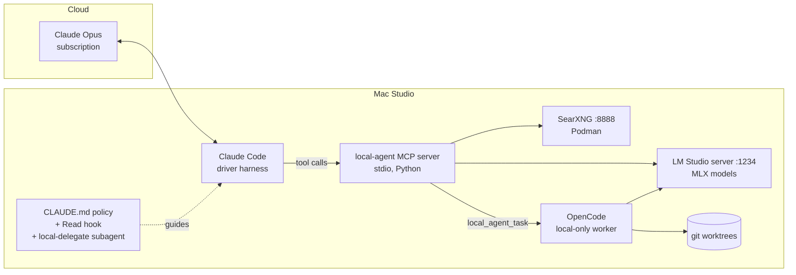

# Mac Studio Local Agent Setup

Turn a Mac Studio (M5 Max, 128 GB) into a **local worker** for a cloud **driver** agent.
Claude Code, logged in with a Claude subscription and running Opus, stays the main driver. It
offloads bulk work to local LLMs through an MCP server: reading many files, crunching logs and
data, multi-page web research, and first-draft code. Opus then reads compact, cited results
instead of raw material.



## Why this shape

- **Claude Code must be the driver.** Claude subscription limits only cover Anthropic's own
  apps (Claude Code, Cowork, etc.). Third-party harnesses such as OpenCode need pay-as-you-go
  API billing to use Claude models. Here, OpenCode is used only as a *worker* on local models
  and never touches Anthropic credentials.
- **MCP is the integration point.** Claude Code's subagents can only run Anthropic models. To
  reach a local model, the driver calls a tool, and the tool's description plus `CLAUDE.md`
  tell it when to do so.
- **Savings come from "large in, small out."** Delegation pays off when the local model reads
  a lot and returns a little: a 2 MB log becomes a 40-line cited brief. Code generation saves
  less, because the driver still has to review what comes back. The `local_usage_report` tool
  measures how much work was actually offloaded.

## What gets built

| Component | Role | Where |
|---|---|---|
| LM Studio (MLX engine) | OpenAI-compatible server for local models | `:1234`, LaunchAgent |
| General model (e.g. gpt-oss-120b) | Reading, synthesis, analysis | ~60–65 GB |
| Coder model (e.g. Qwen3-Coder-30B MoE) | Codegen, agent tasks, fast extraction | ~17–32 GB depending on quant |
| SearXNG | Private metasearch with a JSON API | Podman, `127.0.0.1:8888` |
| `local-agent` MCP server | 10 tools that wrap all of the above | `mcp_server/local_agent_mcp.py` |
| OpenCode | Full local coding agent for `local_agent_task` | `~/.config/opencode/opencode.json` |
| Delegation policy | Tells Opus when to delegate and how to verify | `~/.claude/CLAUDE.md` (managed block) |
| `local-delegate` subagent | Runs on Haiku and keeps tool chatter out of the main context | `~/.claude/agents/` |
| Read hook | Blocks whole-file reads over 256 KB and points to local tools | `~/.claude/hooks/` |

### MCP tools

| Tool | Use it for |
|---|---|
| `local_status` | Health check of models, search, OpenCode, and config |
| `local_ask` | One-shot prompts where the full input fits in the prompt |
| `local_summarize_files` | Questions over many files, directories, or globs; map-reduce with `[file:Lx-y]` citations |
| `local_analyze_data` | Profiling CSV/TSV/JSON/JSONL/Parquet files, plus optional Q&A (opt-in pandas eval) |
| `local_web_search` | SearXNG results (title, URL, snippet) |
| `local_web_fetch` | Extracting a page's text, or answering a question about it locally |
| `local_research` | Search, then fetch N pages, then a synthesized answer with `[n]` sources |
| `local_codegen` | Drafting code from a spec plus context files (nothing written to disk) |
| `local_agent_task` | Running OpenCode in a fresh git worktree/branch, returning a summary and diff stat |
| `local_usage_report` | Tokens processed locally, grouped by tool |

## Build plan

Each phase is a script in `scripts/`, and every script is idempotent. Running `make all` does
everything in order.

### Phase 0: Decisions (before unboxing)
- [ ] Decide which machine runs Claude Code. The **Studio itself** is simplest, since stdio MCP
      needs no network. To drive from a laptop, see [Remote driver](#remote-driver).
- [ ] Choose repo locations and set `LOCAL_AGENT_ALLOWED_ROOTS` (default `~/src:~/data:~/Documents`).
- [ ] Pick models. Check LM Studio's catalog for current MLX builds; the ids used below are
      defaults, not requirements.

### Phase 1: macOS prep: `make prep`
- [ ] Install Xcode CLT, Homebrew, `git jq uv node podman ripgrep fd`, and LM Studio.
- [ ] Raise the GPU wired-memory limit (`iogpu.wired_limit_mb`) to total RAM minus 16 GB, and
      persist it with a LaunchDaemon.
- [ ] Set `pmset`: no sleep on AC, wake-on-LAN, auto-restart after power loss.
- [ ] Install the lock-at-login LaunchAgent. The login agents only run in a logged-in session,
      so for the Studio to recover from a power loss by itself, turn FileVault off
      (`sudo fdesetup disable`), enable auto-login (System Settings > Users & Groups), and set
      `sysadminctl -screenLock immediate -password -` so this agent locks the session right
      after login.
- [ ] Open LM Studio once in the GUI to finish first-run setup.

### Phase 2: Models: `make models`
- [ ] Download the models: gpt-oss as its native MXFP4 GGUF, the coder as MLX.
- [ ] Set LM Studio's JIT default context, stop it auto-loading its bundled model, and (with
      both models preloaded) stop JIT loads of one role from evicting the other.
- [ ] Start the API server on `:1234` and install the login LaunchAgent, which re-pins both
      models after every reboot.
- [ ] In LM Studio's server settings, enable JIT loading and auto-unload, and keep LAN serving **off**.
- [ ] Check memory. Rough budget for running both models with 64k context:

| Item | Approx. GB |
|---|---|
| gpt-oss-120b (MXFP4/MLX) | 60–65 |
| Qwen3-Coder-30B-A3B (8-bit) | ~32 (4-bit ~17) |
| KV caches at 64k ctx | 8–15 |
| macOS + apps + Podman VM | 16–20 |

  If the total gets tight, use the 4-bit coder, a shorter context, or let JIT swap models in
  and out.

### Phase 3: Web search: `make search`
- [ ] Create a Podman VM and run the SearXNG container bound to `127.0.0.1:8888`.
- [ ] Generate `settings.yml` with a random secret and **`json` enabled in `search.formats`**.
- [ ] Install a LaunchAgent that starts the VM and container at login.

### Phase 4: Local worker harness: `make opencode`
- [ ] Install OpenCode and point it at the LM Studio provider (`config/opencode.json`).
- [ ] Use the bash permissions in that config: they allow most commands but deny `git push`,
      `git remote`, `reset --hard`, `sudo`, and `curl | sh`.

### Phase 5: Driver integration: `make claude`
- [ ] Install Claude Code and log in with your subscription (`/login`).
- [ ] Copy config to `~/.config/local-agent/local-agent.env`. The server reads it at startup.
- [ ] Register the server: `claude mcp add --scope user local-agent -- uv run --script <repo>/mcp_server/local_agent_mcp.py`
- [ ] Install the `local-delegate` subagent and the Read hook, and merge the hook into
      `~/.claude/settings.json` (a backup is made first).
- [ ] Append the delegation policy block to `~/.claude/CLAUDE.md`. The block is replaced on re-run.

### Phase 6: Verify: `make verify`
- [ ] Run the layer checks (wired limit, `/v1/models`, SearXNG JSON, binaries, MCP registration).
- [ ] Run the offline unit tests (mocked LLM and search).
- [ ] Run the live stdio smoke test: list tools, then call `local_status` and `local_ask`.
- [ ] In Claude Code, run `/mcp` and confirm `local-agent` shows as connected.

### Phase 7: Tune (first two weeks)
- [ ] Run real work. Check `local_usage_report` and your Claude usage page.
- [ ] If Opus under-delegates, tighten the thresholds in the `CLAUDE.md` block. If it
      over-delegates and quality drops, loosen them.
- [ ] Adjust `LOCAL_CTX_CHARS` and `LOCAL_CHUNK_CHARS` to match your loaded context length.
      Larger chunks mean fewer map calls but slower prefill.
- [ ] Try `LOCAL_CONCURRENCY=3–4` if LM Studio's parallel-request support keeps up.

## POC on a smaller Mac (24 GB): `make poc`

To try the whole stack before the Studio arrives, `make poc` runs phases 2–6 with
`config/local-agent.mini-24gb.env.example` instead of the Studio defaults. Everything else
(LM Studio on `:1234`, SearXNG on `:8888`, OpenCode, the MCP server, the Claude Code policy) is
the same, so moving to the Studio later is a config swap, not a rebuild.

| | Studio (default) | 24 GB POC profile |
|---|---|---|
| general / fast | gpt-oss-120b (~63 GB) | `openai/gpt-oss-20b` (GGUF MXFP4, ~12 GB, MoE) |
| coder / OpenCode | Qwen3-Coder-30B-A3B | `qwen/qwen3.5-9b` (MLX 4-bit, ~6 GB) |
| context | 65,536 tokens, both models pinned | 32,768 tokens, nothing pinned; LM Studio JIT-swaps roles |
| per-call input | 120k chars, 40k chunks | 60k chars, 24k chunks |
| reasoning effort | model default | `low` |
| allowed roots | `~/src:~/data:~/Documents` | adds `~/cc_projects` |
| login agents | installed | skipped (`INSTALL_LAUNCH_AGENTS=1` to install) |
| `make prep` | run | not run (no sudo, wired limit, or pmset changes) |

Only one model fits in GPU memory at a time on 24 GB. With nothing pinned, LM Studio unloads
the previous JIT model when the other role is requested, so the first call after a switch pays
~5–10 s of load time. Models pinned with `lms load` are never unloaded to make room, which is
why the POC profile sets `LOCAL_MODEL_PRELOAD=none` (10-models.sh then just warms the general
model with one request). `10-models.sh` also sets LM Studio's default context length, because
JIT and post-TTL reloads use that default, not the `--context-length` given to `lms load`.

Ports, model ids, and context length all come from the env template, so changing a port means
editing `LOCAL_LLM_BASE_URL` or `SEARXNG_URL` there and re-running `make poc`. Switching an
existing install to another profile needs `FORCE_ENV=1` (the old env file is backed up).

`tests/live_e2e.py` calls every tool against the real stack and is the main POC check:

```bash
uv run --script tests/live_e2e.py               # ~2-3 min on an M4 Pro mini
uv run --script tests/live_e2e.py --skip-agent  # without the OpenCode task
```

### What the POC showed (M4 Pro, 24 GB, October 2026)

- All 10 tools pass end to end (`local_agent_task` passed 5 of 6 runs; the 9B coder is
  not always reliable). gpt-oss-20b runs at ~35–40 tok/s alone; Qwen3.5-9B MLX at ~45.
- `local_summarize_files` over a real 34-file, 234k-char Python app: 42 local calls, ~97k
  tokens read locally, one ~4 KB cited overview back, in ~7.5 min. Most citations were right;
  one named a module path that does not exist, which is why the policy says to spot-check.
- `local_agent_task` with Qwen3.5-9B finishes a small add-function-plus-tests task in ~50 s.
  gpt-oss-20b as the OpenCode model stopped early on the same task, so it stays general-only.
- Limits that are specific to small machines:
  - **Don't mix roles concurrently.** A request for the other model while one is generating
    makes LM Studio swap mid-request; the in-flight request is dropped. The MCP server retries
    once on its side, but an OpenCode task can lose a turn. On the Studio both stay pinned.
  - **Thinking models spend output budget.** Qwen3.5 ignores `reasoning_effort=low`, and at
    codegen's low temperature it sometimes thought until `max_tokens` (4,000 tokens for a
    one-line spec). The POC profile sets `LOCAL_REASONING_EFFORT_CODER=none`, which turns its
    thinking off for MCP calls (OpenCode still thinks). An answer starved by reasoning now
    returns an explicit "used its whole budget on reasoning" error, not an empty string.
  - The machine was already ~10 GB into swap from other apps; pinning both models pushed it
    to 15 GB and cut gpt-oss throughput to ~10 tok/s, which is why nothing is pinned.

### Fixes found while running the POC (apply to the Studio too)

- `local_agent_task` ran OpenCode with the MCP server's stdin and `$PWD`. OpenCode v2 picks
  its project directory from `$PWD`, so the agent edited the directory Claude Code was started
  in instead of the worktree, and could read MCP protocol bytes as prompt. It now gets
  `stdin=/dev/null`, `PWD=<worktree>`, and its own process group, so a timeout really stops
  the agent. (`--standalone` via `OPENCODE_RUN_ARGS` is only for OpenCode v2; see below.)
- JIT reloads used LM Studio's 8k default context, not the 64k given to `lms load`.
- Concurrent first requests to an unloaded model can 500 during the JIT load; map-reduce now
  sends the first chunk alone, and `chat()` retries once on 5xx or swap/cancel errors.
- gpt-oss cites as `【1】`; answers are normalized to `[1]` / `[file:Lx-y]`.
- `00-macos-prep.sh` would have *lowered* the GPU wired limit on machines under 64 GB
  (total − 16 GB); it now reserves 8 GB there.

When the Studio arrives: `make all` there (with `FORCE_ENV=1` if you copied this config over).

### Fixes found while installing the Studio (M5 Max, 128 GB, October 2026)

- `lms get openai/gpt-oss-120b --mlx` resolves to an 8-bit MLX conversion (124 GB) that cannot
  share the GPU with the coder. `10-models.sh` now fetches gpt-oss as its native MXFP4 GGUF
  (63 GB). Cancelling `lms get` does not cancel the job in LM Studio's service: quit LM Studio
  and remove the job from `~/.lmstudio/.internal/download-jobs-info.json`, or it keeps
  downloading in the background.
- A large download can hang at "Finalizing download..." with the weights complete; re-running
  the same `lms get` only fetches the small manifest and registers the model.
- OpenCode 1.19.x (the current release) rejects `--standalone`, so `local_agent_task` failed
  outright. `OPENCODE_RUN_ARGS` now defaults to empty; 1.x `run` already starts a private server.
- The LaunchAgents logged to `/tmp`, tried once after a fixed sleep, and on re-run kept the old
  plist loaded. They now run `scripts/launchd/*-start.sh` (retrying, logging to
  `~/Library/Logs/local-agent-mcp/`), are re-run by launchd until they succeed, and are
  reinstalled with bootout + bootstrap. They also need `AbandonProcessGroup`: without it launchd
  kills the Podman VM (or an LM Studio the script launched) as soon as the start script exits.
- After a reboot the models were only JIT-loaded on first request; the LM Studio agent now
  re-pins both at `LOCAL_MODEL_CTX`.

Measured on the Studio: both models pinned at 64k context use ~75 GB (gpt-oss-120b 59 GiB,
Qwen3-Coder-30B 4-bit 16 GiB) with ~48% of RAM still free; `local_agent_task` finishes the
add-function-plus-tests task in ~10–15 s. One run in five looped until the 900 s timeout, so
keep reviewing its diffs. After a reboot, auto-login → lock → SearXNG → LM Studio with both
models pinned → all 10 tools passing took ~2 minutes.

## Using it

[docs/USAGE.md](docs/USAGE.md) covers what runs on the Studio and every way to use the local
models: Claude Code, the command line (`tools/local-tool`, `claude -p`, and `tools/long-job` for
long goal-driven jobs), OpenCode alone, and the raw API. Things to say to Claude Code:

```text
Use local_summarize_files on ~/src/jump-server/**/*.py: where are SSH sessions opened and
which code paths bypass the audit logger? Then verify the top 3 citations yourself.

Profile ~/data/auth_logs/2026-10.parquet and tell me which hosts had failed-sudo spikes.

local_research: current state of RHEL 9 support for passkeys / FIDO2 for SSH, last 6 months.

Have the local agent add pytest coverage for utils/parsing.py in ~/src/adminibot
(run `pytest -q` until green), then review its diff before we merge.
```

How much control the driver gets: Opus decides on every delegation, guided by the policy.
These four controls set the policy, from soft to hard:
1. **Tool descriptions.** These are always in context and say what each tool is good for.
2. **The `CLAUDE.md` policy.** It sets thresholds and spells out what Opus should keep for itself.
3. **The `local-delegate` subagent.** Opus hands it a whole investigation, and only a short
   brief comes back.
4. **Hooks.** These are hard enforcement. The bundled hook denies big whole-file reads, and you
   can add more (for example, a `PreToolUse` hook on `WebFetch` that points to `local_research`).

## Security notes

- **File access is allow-listed** (`LOCAL_AGENT_ALLOWED_ROOTS`). Paths outside it are refused
  with a clear error, and binary files are skipped.
- **Everything is bound to localhost.** Keep LM Studio's "serve on local network" off.
- **`local_agent_task` runs a real agent that can execute commands.** It always works in a new
  worktree and branch, OpenCode's permission config denies pushes and sudo, and you review the
  diff before merging. For untrusted repos, run it inside a container or VM instead.
- **The pandas eval mode is off by default.** Data files can contain prompt injection, so a
  model told to write code might write hostile code. The expression filter is a speed bump, not
  a sandbox. Enable it (`LOCAL_AGENT_ALLOW_PANDAS_EVAL=1`) only for data you trust.
- **Web content is untrusted.** Results from `local_research` and `local_web_fetch` are
  summaries written by a weaker model. The policy tells Opus to verify load-bearing claims.

## Remote driver

To run Claude Code on a laptop while the Studio does the work, use stdio over SSH. This needs
no open ports beyond SSH.

```bash
claude mcp add --scope user local-agent -- \
  ssh -T studio.local 'cd ~/src/mac_studio_local_agent_setup && ~/.local/bin/uv run --script mcp_server/local_agent_mcp.py'
```

File paths in tool calls are then paths **on the Studio**, so keep the repos you want analyzed
there, or sync them (`git`, `mutagen`, or `rsync`).

## Troubleshooting

| Symptom | Fix |
|---|---|
| `Cannot reach local LLM server` | `~/.lmstudio/bin/lms server start`; check `lms ps` |
| `HTTP 404` / `model not found` | The model id in `local-agent.env` must match `curl localhost:1234/v1/models` |
| SearXNG `403` | `json` is missing from `search.formats`; edit `~/.config/local-agent/searxng/settings.yml`, then `podman restart searxng` |
| SearXNG returns empty results | Upstream engines rate-limit; disable the noisy ones in settings, or wait |
| Very slow map-reduce | Lower `LOCAL_CHUNK_CHARS`, use `model_role="fast"`, narrow the globs |
| Out-of-memory or swapping | Use the 4-bit coder, a shorter `--context-length`, or rely on JIT auto-unload |
| `/mcp` shows failed | Run `uv run --script tests/smoke_stdio.py` to see the server's stderr |
| Service down after a reboot | Check `~/Library/Logs/local-agent-mcp/{lmstudio-server,searxng-agent}.log` and `launchctl print gui/$(id -u)/com.local-agent.<name>`; restart with `launchctl kickstart -k gui/$(id -u)/com.local-agent.<name>` |
| `local_agent_task` exits at once with an OpenCode usage error | OpenCode 1.x; set `OPENCODE_RUN_ARGS=` (empty) in `local-agent.env` |
| `lms get` stuck at "Finalizing download..." | Re-run the same `lms get`; it fetches only the missing manifest |

## Roadmap (optional next steps)

- **Semantic code search:** embed repos with a local embedding model and add a `local_semantic_search` tool.
- **Vision:** use a local VLM for screenshots and scanned PDFs (useful for the genealogy scans too).
- **Streamable-HTTP transport** with a bearer token, so several machines can share one Studio.
- **Per-tool latency and quality logging** in the usage ledger, to tune the delegation thresholds from data.

## Layout

```
mcp_server/local_agent_mcp.py   MCP server (uv inline-deps script; mcp SDK v2)
config/                         env templates (Studio + 24 GB POC), OpenCode, SearXNG, launchd plists
claude/                         CLAUDE.md policy, subagent, Read hook + settings snippet
scripts/00..50-*.sh             phased, idempotent setup
scripts/launchd/                start scripts the LaunchAgents run (retry, log, re-pin models)
tools/local-tool                call any MCP tool from the shell (no Claude needed)
tools/long-job                  goal-driven long job: looped headless Claude + local tools, state in files
docs/USAGE.md                   what runs, and how to use it (Claude Code, CLI, OpenCode, API)
tests/test_offline.py           mocked unit tests (no models needed)
tests/smoke_stdio.py            live smoke test over stdio (status + one ask)
tests/live_e2e.py               live test of every tool against the real stack
```
