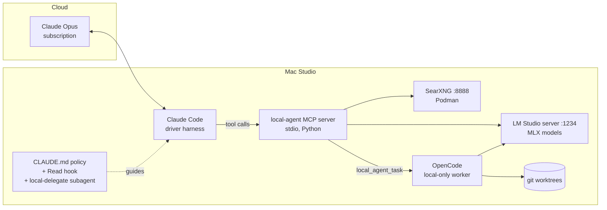

# Mac Studio Local Agent Setup

Turn a Mac Studio (M5 Max, 128 GB) into a **local worker** for a cloud **driver** agent.
Claude Code, logged in with a Claude subscription and running Opus, stays the main driver. It
offloads bulk work to local LLMs through an MCP server: reading many files, crunching logs and
data, multi-page web research, and first-draft code. Opus then reads compact, cited results
instead of raw material.



## Why this shape

- **Claude Code must be the driver.** Claude subscription limits only cover Anthropic's own
  apps (Claude Code, Cowork, etc.). Third-party harnesses such as OpenCode need pay-as-you-go
  API billing to use Claude models. Here, OpenCode is used only as a *worker* on local models
  and never touches Anthropic credentials.
- **MCP is the integration point.** Claude Code's subagents can only run Anthropic models. To
  reach a local model, the driver calls a tool, and the tool's description plus `CLAUDE.md`
  tell it when to do so.
- **Savings come from "large in, small out."** Delegation pays off when the local model reads
  a lot and returns a little: a 2 MB log becomes a 40-line cited brief. Code generation saves
  less, because the driver still has to review what comes back. The `local_usage_report` tool
  measures how much work was actually offloaded.

## What gets built

| Component | Role | Where |
|---|---|---|
| LM Studio (MLX engine) | OpenAI-compatible server for local models | `:1234`, LaunchAgent |
| General model (e.g. gpt-oss-120b) | Reading, synthesis, analysis | ~60–65 GB |
| Coder model (e.g. Qwen3-Coder-30B MoE) | Codegen, agent tasks, fast extraction | ~17–32 GB depending on quant |
| SearXNG | Private metasearch with a JSON API | Podman, `127.0.0.1:8888` |
| `local-agent` MCP server | 10 tools that wrap all of the above | `mcp_server/local_agent_mcp.py` |
| OpenCode | Full local coding agent for `local_agent_task` | `~/.config/opencode/opencode.json` |
| Delegation policy | Tells Opus when to delegate and how to verify | `~/.claude/CLAUDE.md` (managed block) |
| `local-delegate` subagent | Runs on Haiku and keeps tool chatter out of the main context | `~/.claude/agents/` |
| Read hook | Blocks whole-file reads over 256 KB and points to local tools | `~/.claude/hooks/` |

### MCP tools

| Tool | Use it for |
|---|---|
| `local_status` | Health check of models, search, OpenCode, and config |
| `local_ask` | One-shot prompts where the full input fits in the prompt |
| `local_summarize_files` | Questions over many files, directories, or globs; map-reduce with `[file:Lx-y]` citations |
| `local_analyze_data` | Profiling CSV/TSV/JSON/JSONL/Parquet files, plus optional Q&A (opt-in pandas eval) |
| `local_web_search` | SearXNG results (title, URL, snippet) |
| `local_web_fetch` | Extracting a page's text, or answering a question about it locally |
| `local_research` | Search, then fetch N pages, then a synthesized answer with `[n]` sources |
| `local_codegen` | Drafting code from a spec plus context files (nothing written to disk) |
| `local_agent_task` | Running OpenCode in a fresh git worktree/branch, returning a summary and diff stat |
| `local_usage_report` | Tokens processed locally, grouped by tool |

## Build plan

Each phase is a script in `scripts/`, and every script is idempotent. Running `make all` does
everything in order.

### Phase 0: Decisions (before unboxing)
- [ ] Decide which machine runs Claude Code. The **Studio itself** is simplest, since stdio MCP
      needs no network. To drive from a laptop, see [Remote driver](#remote-driver).
- [ ] Choose repo locations and set `LOCAL_AGENT_ALLOWED_ROOTS` (default `~/src:~/data:~/Documents`).
- [ ] Pick models. Check LM Studio's catalog for current MLX builds; the ids used below are
      defaults, not requirements.

### Phase 1: macOS prep: `make prep`
- [ ] Install Xcode CLT, Homebrew, `git jq uv node podman ripgrep fd`, and LM Studio.
- [ ] Raise the GPU wired-memory limit (`iogpu.wired_limit_mb`) to total RAM minus 16 GB, and
      persist it with a LaunchDaemon.
- [ ] Set `pmset`: no sleep on AC, wake-on-LAN, auto-restart after power loss.
- [ ] Open LM Studio once in the GUI to finish first-run setup.

### Phase 2: Models: `make models`
- [ ] Download the general and coder models as MLX builds.
- [ ] Start the API server on `:1234` and install the login LaunchAgent.
- [ ] In LM Studio's server settings, enable JIT loading and auto-unload, and keep LAN serving **off**.
- [ ] Check memory. Rough budget for running both models with 64k context:

| Item | Approx. GB |
|---|---|
| gpt-oss-120b (MXFP4/MLX) | 60–65 |
| Qwen3-Coder-30B-A3B (8-bit) | ~32 (4-bit ~17) |
| KV caches at 64k ctx | 8–15 |
| macOS + apps + Podman VM | 16–20 |

  If the total gets tight, use the 4-bit coder, a shorter context, or let JIT swap models in
  and out.

### Phase 3: Web search: `make search`
- [ ] Create a Podman VM and run the SearXNG container bound to `127.0.0.1:8888`.
- [ ] Generate `settings.yml` with a random secret and **`json` enabled in `search.formats`**.
- [ ] Install a LaunchAgent that starts the VM and container at login.

### Phase 4: Local worker harness: `make opencode`
- [ ] Install OpenCode and point it at the LM Studio provider (`config/opencode.json`).
- [ ] Use the bash permissions in that config: they allow most commands but deny `git push`,
      `git remote`, `reset --hard`, `sudo`, and `curl | sh`.

### Phase 5: Driver integration: `make claude`
- [ ] Install Claude Code and log in with your subscription (`/login`).
- [ ] Copy config to `~/.config/local-agent/local-agent.env`. The server reads it at startup.
- [ ] Register the server: `claude mcp add --scope user local-agent -- uv run --script <repo>/mcp_server/local_agent_mcp.py`
- [ ] Install the `local-delegate` subagent and the Read hook, and merge the hook into
      `~/.claude/settings.json` (a backup is made first).
- [ ] Append the delegation policy block to `~/.claude/CLAUDE.md`. The block is replaced on re-run.

### Phase 6: Verify: `make verify`
- [ ] Run the layer checks (wired limit, `/v1/models`, SearXNG JSON, binaries, MCP registration).
- [ ] Run the offline unit tests (mocked LLM and search).
- [ ] Run the live stdio smoke test: list tools, then call `local_status` and `local_ask`.
- [ ] In Claude Code, run `/mcp` and confirm `local-agent` shows as connected.

### Phase 7: Tune (first two weeks)
- [ ] Run real work. Check `local_usage_report` and your Claude usage page.
- [ ] If Opus under-delegates, tighten the thresholds in the `CLAUDE.md` block. If it
      over-delegates and quality drops, loosen them.
- [ ] Adjust `LOCAL_CTX_CHARS` and `LOCAL_CHUNK_CHARS` to match your loaded context length.
      Larger chunks mean fewer map calls but slower prefill.
- [ ] Try `LOCAL_CONCURRENCY=3–4` if LM Studio's parallel-request support keeps up.

## Using it

Things to say to Claude Code:

```text
Use local_summarize_files on ~/src/jump-server/**/*.py: where are SSH sessions opened and
which code paths bypass the audit logger? Then verify the top 3 citations yourself.

Profile ~/data/auth_logs/2026-10.parquet and tell me which hosts had failed-sudo spikes.

local_research: current state of RHEL 9 support for passkeys / FIDO2 for SSH, last 6 months.

Have the local agent add pytest coverage for utils/parsing.py in ~/src/adminibot
(run `pytest -q` until green), then review its diff before we merge.
```

How much control the driver gets: Opus decides on every delegation, guided by the policy.
These four controls set the policy, from soft to hard:
1. **Tool descriptions.** These are always in context and say what each tool is good for.
2. **The `CLAUDE.md` policy.** It sets thresholds and spells out what Opus should keep for itself.
3. **The `local-delegate` subagent.** Opus hands it a whole investigation, and only a short
   brief comes back.
4. **Hooks.** These are hard enforcement. The bundled hook denies big whole-file reads, and you
   can add more (for example, a `PreToolUse` hook on `WebFetch` that points to `local_research`).

## Security notes

- **File access is allow-listed** (`LOCAL_AGENT_ALLOWED_ROOTS`). Paths outside it are refused
  with a clear error, and binary files are skipped.
- **Everything is bound to localhost.** Keep LM Studio's "serve on local network" off.
- **`local_agent_task` runs a real agent that can execute commands.** It always works in a new
  worktree and branch, OpenCode's permission config denies pushes and sudo, and you review the
  diff before merging. For untrusted repos, run it inside a container or VM instead.
- **The pandas eval mode is off by default.** Data files can contain prompt injection, so a
  model told to write code might write hostile code. The expression filter is a speed bump, not
  a sandbox. Enable it (`LOCAL_AGENT_ALLOW_PANDAS_EVAL=1`) only for data you trust.
- **Web content is untrusted.** Results from `local_research` and `local_web_fetch` are
  summaries written by a weaker model. The policy tells Opus to verify load-bearing claims.

## Remote driver

To run Claude Code on a laptop while the Studio does the work, use stdio over SSH. This needs
no open ports beyond SSH.

```bash
claude mcp add --scope user local-agent -- \
  ssh -T studio.local 'cd ~/src/mac_studio_local_agent_setup && ~/.local/bin/uv run --script mcp_server/local_agent_mcp.py'
```

File paths in tool calls are then paths **on the Studio**, so keep the repos you want analyzed
there, or sync them (`git`, `mutagen`, or `rsync`).

## Troubleshooting

| Symptom | Fix |
|---|---|
| `Cannot reach local LLM server` | `~/.lmstudio/bin/lms server start`; check `lms ps` |
| `HTTP 404` / `model not found` | The model id in `local-agent.env` must match `curl localhost:1234/v1/models` |
| SearXNG `403` | `json` is missing from `search.formats`; edit `~/.config/local-agent/searxng/settings.yml`, then `podman restart searxng` |
| SearXNG returns empty results | Upstream engines rate-limit; disable the noisy ones in settings, or wait |
| Very slow map-reduce | Lower `LOCAL_CHUNK_CHARS`, use `model_role="fast"`, narrow the globs |
| Out-of-memory or swapping | Use the 4-bit coder, a shorter `--context-length`, or rely on JIT auto-unload |
| `/mcp` shows failed | Run `uv run --script tests/smoke_stdio.py` to see the server's stderr |

## Roadmap (optional next steps)

- **Semantic code search:** embed repos with a local embedding model and add a `local_semantic_search` tool.
- **Vision:** use a local VLM for screenshots and scanned PDFs (useful for the genealogy scans too).
- **Streamable-HTTP transport** with a bearer token, so several machines can share one Studio.
- **Per-tool latency and quality logging** in the usage ledger, to tune the delegation thresholds from data.

## Layout

```
mcp_server/local_agent_mcp.py   MCP server (uv inline-deps script; mcp SDK v2)
config/                         env template, OpenCode, SearXNG, launchd plists
claude/                         CLAUDE.md policy, subagent, Read hook + settings snippet
scripts/00..50-*.sh             phased, idempotent setup
tests/test_offline.py           mocked unit tests (no models needed)
tests/smoke_stdio.py            live end-to-end test over stdio
```
